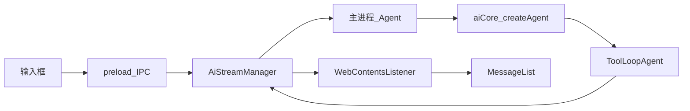

# 学 Cherry Studio

这是一份给前端开发者的知识导航。Cherry Studio 是用 TypeScript 写的桌面 AI 客户端。你已经会 React，这里带你从消息界面走到模型调用和 agent 循环。

每一课一次碎片时间能看完。看懂「这段代码在整条链上干什么」就够了，想深入时再打开源文件。

## 我是前端，从这里开始

1. [怎么读这份导航](/start/how-to-read)
2. [三块代码](/map/three-parts)
3. [一条消息的全程](/map/one-message)
4. 然后按侧边栏往下：界面、进程边界、模型调用、agent 运行时

## 一条消息怎么走

输入框和消息列表都在渲染进程里，它们是并列的两块界面。发送走 IPC，模型在主进程里跑，文字再推回消息列表。

转型时最值得反复看的三处：

- 界面契约：[列表契约](/ui/contract)
- 模型入口：[createAgent](/model/create-agent)
- 事件怎么变成消息：[文本增量](/runtime/text-delta)
