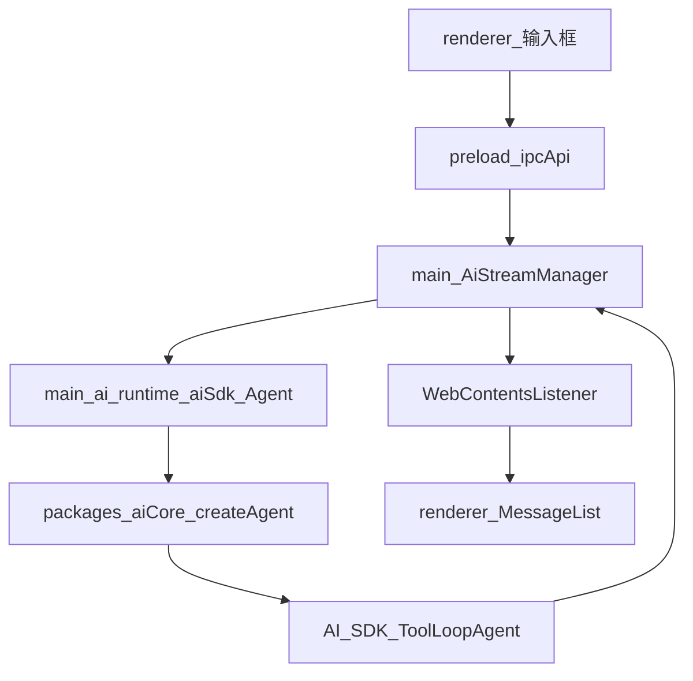

# 一条消息的全程

预计 15 分钟。这一课只认箭头。

## 这一坐要看懂什么

用户在输入框打字，消息列表把回复画出来。这两块界面互不调用。输入框把请求交给主进程，主进程跑模型，再把增量推回当前窗口，消息列表只负责订阅结果。

后面每一课都是这条链上的一截。

## 先打开哪个文件

先不要打开实现。把上面的箭头和侧边栏对上：

- 输入框和 `MessageList`：界面课
- `preload`：进程边界第一课
- `AiStreamManager`、`WebContentsListener`：进程边界后两课
- `createAgent` 和 `Agent`：模型调用课
- `ToolLoopAgent` 来自依赖 `ai`，仓库里是调用它，不是重写它

## 关键代码

链上的六个落点：

| 箭头 | 文件 |
| --- | --- |
| 列表怎么画 | `src/renderer/components/chat/messages/MessageList.tsx` |
| 渲染进程发出请求 | `src/preload/ipc.ts` |
| 谁在听流、谁在存消息 | `src/main/ai/streamManager/AiStreamManager.ts` |
| 推回这个窗口 | `src/main/ai/streamManager/listeners/WebContentsListener.ts` |
| 产品里的循环外壳 | `src/main/ai/runtime/aiSdk/Agent.ts` |
| 交给 AI SDK 的那一层 | `packages/aiCore/src/core/agents/createAgent.ts` |

## 记住这一点

`MessageList` 不发送消息。它从上下文里拿已经准备好的 `messages` 和 `parts`，然后画出来。

## 先不要展开的目录

- `src/renderer/components/composer`：输入框本体。知道它在列表外面即可。
- `src/main/ai/runtime/pi` 和 `claudeCode`：另一条编码 agent 的后端，运行时课再认门。
