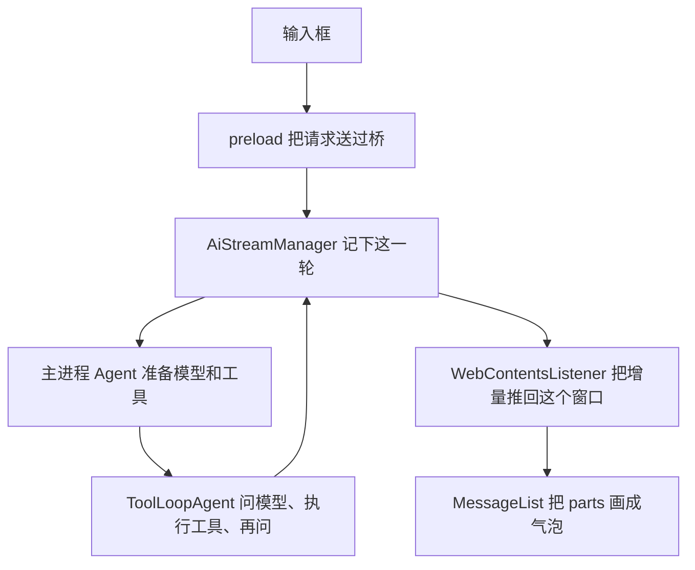

# 一条消息的全程

这一课把整门课的地图走一遍。后面每一课都是这条链上的一截，这里先知道每截负责什么，看到代码时才知道自己在链的哪一段。

## 一句话出去再回来

你在输入框打「今天北京天气怎么样」，按发送。输入框和消息列表是两块并列的 React 界面。列表不负责发送。发送的是输入框，它通过 preload 请主进程开工。

沿着箭头看这一句话：

1. 输入框把文本交给 preload。preload 用 `ipcRenderer.invoke` 叫主进程的某个路由。页面拿到的是一个 Promise，还没有模型的回复。
2. 主进程的 `AiStreamManager` 为这个话题登记一轮流。它自己不调用 OpenAI。它负责「这轮还在不在跑、谁在听、结束时写进数据库」。
3. 真正问模型的是主进程里的 `Agent`。它带上系统提示、历史消息、工具，调用 `createAgent`。
4. `createAgent` 把厂商和插件准备好，交给 AI SDK 的 `ToolLoopAgent`。模型如果决定先搜网页，循环会执行搜索工具，把结果送回模型，再继续生成「今天北京……」。
5. 生成过程中的每一个小片段，由 `WebContentsListener` 发给当前窗口。大约每 16 毫秒合并一次，避免一个 token 一次 IPC。
6. 渲染进程已经用 `on` 订了 `ai.stream.chunk`。片段被放进对应消息的 parts。`MessageList` 只是把这些 parts 画出来。正文 part 还在增长时，气泡就表现为逐字出现。

模型最后不再调用工具，循环结束。调度台通知听众这轮完成，数据库里留下完整消息。

## 两条不要混的路

上面是普通聊天。仓库里还有 Pi、Claude Code 这种编码助手。它们自己带循环和工具，Cherry 用 `packages/agent-runtime` 把它们的事件收成同样的消息和 parts。界面仍然是同一个 `MessageList`。那是后半段的课，现在只要知道：气泡长一样，背后跑循环的人可能不同。

## 接下来

从你熟悉的界面开始。窗口里有很多标签，[一个 Tab 一份路由](/ui/router) 说明聊天页是怎么被挂出来的。

源码会在后面每课里展开。这一页对应的六个落点是 `MessageList.tsx`、`src/preload/ipc.ts`、`AiStreamManager.ts`、`WebContentsListener.ts`、`runtime/aiSdk/Agent.ts`、`packages/aiCore` 的 `createAgent.ts`。
